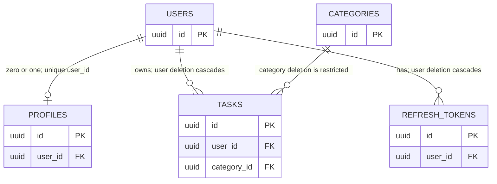

# Technical Architecture and Implementation Details

This guide describes the application as it is implemented today.

> **Docker note:** Docker Compose starts PostgreSQL only. It does not start the frontend, backend, migrations, or seed. See the [Application Setup Guide](TECHNICAL_SETUP.md).

## Contents

- [Technology stack](#technology-stack)
- [How Drizzle is used](#how-drizzle-is-used)
- [Database tables](#database-tables)
- [Entity relationships](#entity-relationships)
- [Backend architecture](#backend-architecture)
- [Authentication](#authentication)
- [API and Swagger](#api-and-swagger)
- [Frontend architecture](#frontend-architecture)
- [Testing](#testing)

## Technology stack

### Frontend

| Technology | Purpose |
| --- | --- |
| React, React DOM, TypeScript | Build the typed user interface. |
| React Router | Route between login, registration, dashboard, category tasks, and profile pages. |
| Vite | Frontend development server and build tool. |
| Axios | Call the API and attach access tokens/cookies. |
| Vitest, jsdom, Testing Library | Run browser-like component tests. |
| Project CSS | Custom styling and responsive layouts in `App.css` and `index.css`; no UI or CSS framework is configured. |

### Backend

| Technology | Purpose |
| --- | --- |
| Node.js, NestJS, TypeScript | Run the HTTP API and organize it into modules, controllers, and services. |
| `pg`, Drizzle ORM, Drizzle Kit | Connect to PostgreSQL, query typed tables, and manage migrations. |
| `class-validator`, `class-transformer` | Validate and transform request DTOs. |
| `@nestjs/swagger` | Generate Swagger UI and OpenAPI documentation. |
| Passport, `passport-jwt`, `@nestjs/jwt` | Validate Bearer access tokens and issue JWTs. |
| bcrypt | Hash and compare account passwords. |
| `cookie-parser` | Read the refresh-token cookie on auth routes. |
| Jest, `@nestjs/testing`, Supertest | Run backend unit, HTTP end-to-end, and repository integration tests. |

### Database and infrastructure

The database is PostgreSQL. Docker Compose uses the `postgres:16` image and a named volume for persistence. The Compose file currently has no frontend or backend containers.

## How Drizzle is used

The repository does not record the original decision for choosing Drizzle. In the current implementation, it provides:

- TypeScript definitions for PostgreSQL tables, columns, and relations.
- Inferred database row types for repository code.
- A query builder used by repositories and services.
- SQL migration generation and execution through Drizzle Kit.

The schema is under [`backend/src/database/schema/`](../backend/src/database/schema/). `relations.ts` describes Drizzle relations; the schema declarations and SQL migration define the actual database constraints.

The database provider creates a `pg.Pool`, passes it to `drizzle()`, and makes the typed database available through Nest dependency injection.

| Operation | Drizzle pattern used |
| --- | --- |
| Insert | `insert(table).values(...).returning()` |
| Select | `select().from(table).where(...)` |
| Update | `update(table).set(...).where(...).returning()` |
| Delete | `delete(table).where(...)` |
| Transaction | `transaction(async (tx) => ...)` for creating a user and profile atomically |

See the [task repository](../backend/src/tasks/tasks.repository.ts) and [auth repository](../backend/src/auth/auth.repository.ts). Categories and profiles query Drizzle directly from their services.

The initial migration is [`backend/migrations/0000_calm_starfox.sql`](../backend/migrations/0000_calm_starfox.sql). Root scripts include `npm run db:generate`, `npm run db:migrate`, and `npm run db:seed`. Migrations do not run automatically when the backend starts.

The seed inserts the shared `Work` and `Personal` categories and ignores duplicate names. These npm scripts are not run by the current Docker Compose configuration.

## Database tables

The tables are defined in `backend/src/database/schema/` and represented in the initial SQL migration.

**Conventions:** UUID primary keys default to `gen_random_uuid()`. Timestamp columns use `timestamptz NOT NULL DEFAULT now()`. Columns marked nullable have no `NOT NULL` constraint.

### `users`

Stores account names and password hashes.

| Column | Type | Constraints and default |
| --- | --- | --- |
| `id` | `uuid` | Primary key; `gen_random_uuid()` |
| `username` | `varchar(100)` | NOT NULL, unique |
| `password_hash` | `varchar(255)` | NOT NULL |
| `created_at` | `timestamptz` | NOT NULL; `now()` |
| `updated_at` | `timestamptz` | NOT NULL; `now()` |

The unique username constraint also enforces uniqueness at the database level.

### `profiles`

Stores optional profile fields. Registration creates a profile with the user, but the database permits a user without one.

| Column | Type | Constraints and default |
| --- | --- | --- |
| `id` | `uuid` | Primary key; `gen_random_uuid()` |
| `user_id` | `uuid` | NOT NULL, unique FK to `users.id`; delete cascades |
| `name` | `varchar(150)` | Nullable |
| `age` | `integer` | Nullable |
| `profession` | `varchar(150)` | Nullable |
| `created_at` | `timestamptz` | NOT NULL; `now()` |
| `updated_at` | `timestamptz` | NOT NULL; `now()` |

The unique `user_id` allows at most one profile per user. The profile DTO validates age as an integer from 1 to 150; this range is not a database constraint.

### `categories`

Stores categories shared by all users. Categories are not user-owned.

| Column | Type | Constraints and default |
| --- | --- | --- |
| `id` | `uuid` | Primary key; `gen_random_uuid()` |
| `name` | `varchar(50)` | NOT NULL, unique |
| `created_at` | `timestamptz` | NOT NULL; `now()` |

The seed provides `Work` and `Personal`. There is no category create, edit, or delete API.

### `tasks`

Stores tasks owned by a user and assigned to a category.

| Column | Type | Constraints and default |
| --- | --- | --- |
| `id` | `uuid` | Primary key; `gen_random_uuid()` |
| `user_id` | `uuid` | NOT NULL FK to `users.id`; delete cascades |
| `category_id` | `uuid` | NOT NULL FK to `categories.id`; delete is restricted |
| `task_name` | `varchar(255)` | NOT NULL |
| `description` | `text` | Nullable |
| `status` | `task_status` enum | NOT NULL; `ACTIVE` by default; values: `ACTIVE`, `COMPLETED` |
| `created_at` | `timestamptz` | NOT NULL; `now()` |
| `updated_at` | `timestamptz` | NOT NULL; `now()` |

Indexes:

- `tasks_user_id_idx` on `user_id`
- `tasks_category_id_idx` on `category_id`
- `tasks_status_idx` on `status`
- `tasks_user_category_idx` on `(user_id, category_id)`

Every task must reference one existing user and category. Deleting a user cascades to their tasks. A category cannot be deleted while tasks reference it. Task deletion and category clearing physically delete rows; tasks are not soft-deleted.

### `refresh_tokens`

Stores refresh-session records. There is no separate `sessions` table. The database stores a SHA-256 hash of each refresh token, not the raw token.

| Column | Type | Constraints and default |
| --- | --- | --- |
| `id` | `uuid` | Primary key; `gen_random_uuid()` |
| `user_id` | `uuid` | NOT NULL FK to `users.id`; delete cascades |
| `token_hash` | `varchar(255)` | NOT NULL |
| `expires_at` | `timestamptz` | NOT NULL |
| `created_at` | `timestamptz` | NOT NULL; `now()` |

Indexes are `refresh_tokens_user_id_idx` on `user_id` and `refresh_tokens_hash_idx` on `token_hash`. The hash index is not unique. Deleting a user cascades to their refresh-token rows.

## Entity relationships



The database permits a user to have zero or one profile; registration creates one. Every profile, task, and refresh-token row must reference a user. Each task must also reference one category.

## Backend architecture

The root module imports `DatabaseModule`, `AuthModule`, `ProfilesModule`, `CategoriesModule`, and `TasksModule`. The root controller and service provide the health endpoint.

| Layer | Responsibility |
| --- | --- |
| Modules | Group controllers and providers for dependency injection. |
| Controllers | Define routes, bind inputs, apply guards, and obtain the authenticated user. |
| Services | Enforce application rules such as ownership and category existence. |
| Repositories | Encapsulate auth and task queries. Category and profile services use Drizzle directly. |
| DTOs | Define accepted fields and validation rules; DTO metadata also supplies Swagger schemas. |
| Database provider | Creates the PostgreSQL pool and typed Drizzle instance. |

Typical request flow:

```text
HTTP -> Controller -> Service -> Repository -> Drizzle -> PostgreSQL
```

Category and profile flows omit the repository layer:

```text
HTTP -> Controller -> Service -> Drizzle -> PostgreSQL
```

At startup, `main.ts` enables cookie parsing and credentialed CORS. Its global `ValidationPipe` uses `whitelist`, `transform`, and `forbidNonWhitelisted`: extra request fields are rejected, accepted values are transformed, and DTO validators check types, lengths, UUIDs, enums, and profile age. Nest's built-in exceptions handle errors; there is no custom global exception filter.

Task ownership comes from the JWT's `sub` claim. `GET /tasks` does not accept a user ID. It always filters by the authenticated user and optionally filters by category or status. Pagination is not implemented.

## Authentication

### Request flow

| Step | Route | What happens |
| --- | --- | --- |
| Register | `POST /auth/register` | Public. Checks username uniqueness, hashes the password with bcrypt, and creates the user and profile in a transaction. Registration does not log the user in. |
| Login | `POST /auth/login` | Public. Compares the password hash, returns `accessToken` and user identity as JSON, and sets a refresh-token cookie. |
| Protected request | Protected APIs | Passport validates the Bearer JWT. Its `sub` claim identifies the current user. |
| Refresh | `POST /auth/refresh` | Reads the cookie, validates its stored hash and expiry, deletes the old session, and issues a new access token and refresh session. |
| Logout | `POST /auth/logout` | Deletes the matching refresh-token row when a cookie is supplied, then clears the cookie. The route does not require an access token. |

### Token and cookie details

- Access tokens are JWTs containing `sub` (user ID) and `username`. They expire after one day.
- The access-token secret is read from `JWT_ACCESS_SECRET`; code has a development fallback if it is unset.
- Refresh tokens are opaque random values: the server generates 48 random bytes and encodes them as base64url.
- Only the SHA-256 refresh-token hash is stored in `refresh_tokens`. Sessions expire after three days and rotate on refresh.
- The refresh cookie is named `refreshToken`, is `HttpOnly`, has path `/auth`, and has a three-day max age.
- In production, the cookie uses `Secure` and `SameSite=Strict`. In other environments it is non-secure and uses `SameSite=Lax`.
- The frontend sends cookies with Axios `withCredentials`. `JWT_REFRESH_SECRET`, `ACCESS_TOKEN_EXPIRY`, and `REFRESH_TOKEN_EXPIRY` from the backend example file are not read by the application; current token durations are set in code.

```mermaid
sequenceDiagram
    actor Browser
    participant API
    participant DB as PostgreSQL

    Browser->>API: POST /auth/register
    API->>DB: Insert user and profile in a transaction
    API-->>Browser: User identity
    Browser->>API: POST /auth/login
    API->>DB: Verify credentials and store refresh-token hash
    API-->>Browser: accessToken and user; set refreshToken cookie
    Browser->>API: Protected request with Bearer accessToken
    API->>API: Validate JWT and identify user
    Browser->>API: POST /auth/refresh with cookie
    API->>DB: Validate and replace refresh session
    API-->>Browser: New accessToken and rotated cookie
    Browser->>API: POST /auth/logout with cookie
    API->>DB: Delete matching refresh-token row
    API-->>Browser: Clear refreshToken cookie
```

## API and Swagger

Swagger is configured in `backend/src/swagger.ts`.

| URL | Purpose |
| --- | --- |
| `http://localhost:3001/api/docs` | Swagger UI |
| `http://localhost:3001/api/docs-json` | OpenAPI document |

These URLs assume the backend is running on its default port. Swagger groups endpoints under Authentication, Tasks, Categories, Profile, and Health. Protected operations use a Bearer JWT scheme; registration and login are public.

Swagger does not extract a token from the login response. Copy `accessToken` from `POST /auth/login`, select **Authorize**, and paste the token. Authorization persistence and Try it out are enabled. The refresh cookie is separate from Bearer authorization.

| Method | Route | Access and behavior |
| --- | --- | --- |
| `GET` | `/` | Health greeting. |
| `POST` | `/auth/register` | Public registration. |
| `POST` | `/auth/login` | Public login; returns access token and sets refresh cookie. |
| `POST` | `/auth/refresh` | Uses and rotates the refresh cookie. |
| `POST` | `/auth/logout` | Revokes the refresh session when a cookie is supplied and clears it. |
| `GET` | `/auth/me` | Protected; returns the current user's identity. |
| `GET` | `/categories` | Protected; lists shared categories. No category creation route exists. |
| `POST` | `/tasks` | Protected; creates a task for the current user. |
| `GET` | `/tasks` | Protected; lists the current user's tasks; optional `categoryId` and `status` filters. |
| `GET` | `/tasks/:id` | Protected; retrieves an owned task. |
| `PATCH` | `/tasks/:id` | Protected; partially updates an owned task. |
| `PATCH` | `/tasks/:id/status` | Protected; sets status to `ACTIVE` or `COMPLETED`. |
| `DELETE` | `/tasks/:id` | Protected; physically deletes an owned task. |
| `DELETE` | `/tasks/category/:categoryId` | Protected; physically deletes the current user's tasks in that category. |
| `GET` | `/profile` | Protected; returns the current user's profile. |
| `PATCH` | `/profile` | Protected; partially updates the current user's profile. |

Swagger's sample IDs are illustrative. For task requests, call `GET /categories` and use an ID from its response.

## Frontend architecture

### Routes and authentication

- `App.tsx` defines public login and registration pages.
- Dashboard, Work, Personal, and profile pages are protected routes.
- `AuthContext` stores the current user and attempts `POST /auth/refresh` when the app starts.
- The access token is kept in memory, not browser storage. Logout calls the API and clears the token and user state.

### API client

The Axios client uses `VITE_API_URL` (default `http://localhost:3001`) and `withCredentials: true`.

- A request interceptor adds the in-memory Bearer token.
- On a 401 response, the client attempts a refresh and retries the original request.
- Concurrent 401 responses share one refresh request.

### Main pages and data flow

- **Dashboard:** fetches `/tasks` and `/categories` concurrently. It calculates total tasks from the task array length, counts `ACTIVE` and `COMPLETED` tasks by filtering, and counts category tasks by matching `categoryId`. The categories are dynamic; seeded Work and Personal records create those two KPI cards. Counts are calculated in the browser, not returned as database aggregates.
- **Work and Personal:** `CategoryTasks` finds the selected category by name, fetches its tasks, and supports create, edit, status toggle, delete, and clear-all for the current user.
- **Task form:** `TaskForm` provides task creation inputs.
- **Profile:** reads and updates name, age, and profession. Username is read-only.
- **Styling:** `App.css` and `index.css` contain custom layout and responsive styles.

## Testing

The current Compose file has no frontend, backend, or test services, so **there are no Docker-based test commands configured**. The following npm scripts exist for environments where the dependencies are installed:

| Command from the repository root | Test scope |
| --- | --- |
| `npm test` | Backend Jest unit tests, then frontend Vitest tests. |
| `npm run test:e2e` | Backend HTTP end-to-end tests. |
| `npm run test:unit --prefix backend` | Backend unit tests only. |
| `npm --prefix backend run test:integration` | Backend PostgreSQL repository integration tests. |
| `npm --prefix frontend test` | Frontend Vitest tests only. |

### Unit tests

Backend unit suites cover auth repository/service behavior, environment and database URL validation, and task controller, DTO, repository, and service behavior. They use Jest and mock dependencies such as database access, repository collaborators, bcrypt, or JWT where appropriate. There are no dedicated category or profile unit suites.

Frontend tests use Vitest, jsdom, and Testing Library. Current page-level coverage includes login and category-task behavior.

### PostgreSQL integration tests

The auth and task repository integration suites use PostgreSQL. They read `TEST_DATABASE_URL` directly from the process environment and skip when it is absent.

The database name must contain `test` as a delimited segment (for example, separated by `_` or `-`). Each suite creates a random temporary schema and creates its tables using inline SQL. It does not apply the checked-in migration or create/drop the test database.

After each suite, connections close and the temporary schema is dropped. The tests cover repository operations and constraints including transaction rollback, refresh-session hashing and expiry, task ownership, user-delete cascades, and category-delete restriction.

### HTTP end-to-end tests

`backend/tests/e2e/app.e2e-spec.ts` uses Nest's testing module and Supertest. It tests Swagger security setup, public registration/login, protected task requests, ownership, validation, filtering, task CRUD, status updates, and deletion.

Database-facing providers are replaced with mocks and in-memory records, so the e2e suite does not verify PostgreSQL persistence.
